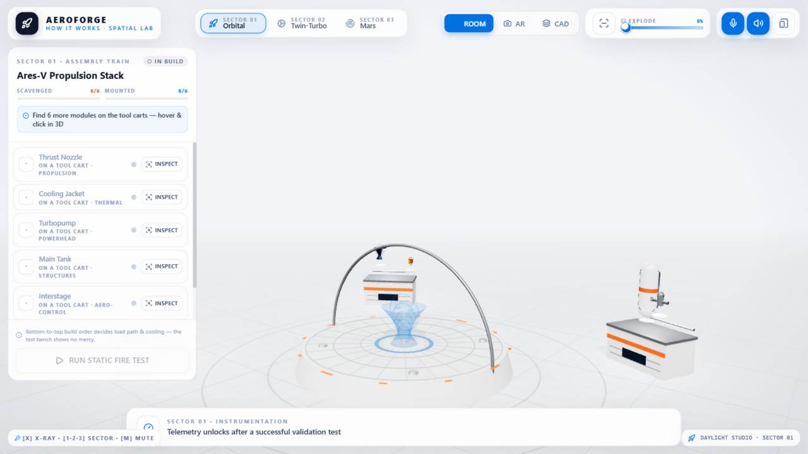
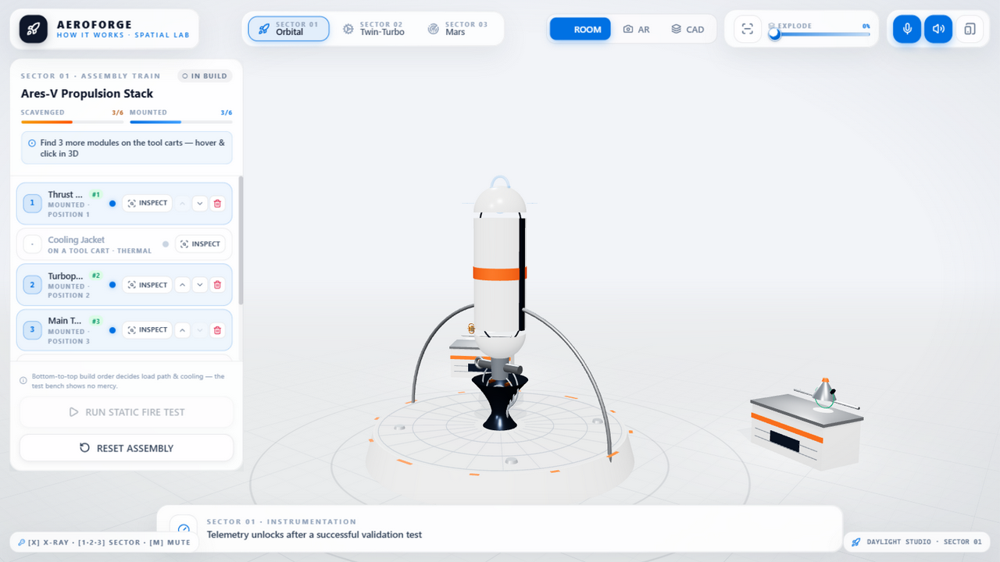

<div align="center">

# 🚀 AEROFORGE — HOW IT WORKS

### A Spatial Engineering Lab & Escape Simulator built with React Three Fiber

**Scavenge real machine modules. Learn how they actually work. Assemble them in the correct
engineering order. Survive the test — or watch physics destroy your build in spectacular 3D.**

[](https://react.dev)
[](https://threejs.org)
[](https://docs.pmnd.rs)
[](https://www.typescriptlang.org)
[](https://vite.dev)
[](https://tailwindcss.com)
[](LICENSE)

**🤖 This entire application — every line of code, every procedural mesh, every synthesized
sound and physics formula — was built 100% with [Wisper Flow](#-built-with-wisper-flow).**

</div>

---



<div align="center"><sub>The AEROFORGE daylight studio — open cyclorama, CNC turntable pedestal, tool carts and frosted-glass HUD.</sub></div>

---

## 🎯 What is this?

AEROFORGE is a **3D engineering escape game** that satisfies the oldest question in
technology: *"How do complex machines **actually** work?"*

You are locked inside an aerospace R&D facility. Each sector seals one machine — a
cryogenic rocket, a twin-turbo V8, a Mars coaxial helicopter — torn down into its real
subsystems and hidden across the studio. To escape you must:

| Step | What you do | What you learn |
|:---:|---|---|
| 1️⃣ | **Scavenge** modules floating on tool carts around the studio | What each subsystem physically *is* |
| 2️⃣ | **Inspect** every module in the Curiosity Inspector | *Explain-Like-I'm-10* ⇄ *Aerospace-Engineer* mode, with live physics sliders (real formulas: Isp, Otto efficiency, momentum-theory hover power…) |
| 3️⃣ | **Assemble** bottom-to-top on the CNC turntable (click-to-mount or 3D drag-and-snap) | Load paths, cooling chains, firing trains — *order matters* |
| 4️⃣ | **Run the test** — static fire, dyno ignition or hover trial | What happens when the order is wrong… |
| 5️⃣ | **Watch the climax** — launch with live telemetry, ride the dyno, or free-fly the drone | Why every part earns its place |

Assemble anything out of order and the simulator teaches you **why it fails** — with a
full 3D physics failure animation and an engineering post-mortem.

## 🧪 The Failure Lab

Wrong builds don't just say "error". They show you the physics:

| Mistake | Failure Simulation | The Lesson |
|---|---|---|
| Cooling jacket missing / misplaced | 🔥 **Thermal Meltdown** — nozzle glows incandescent, 220-particle explosion, klaxon | Regenerative cooling must hug the 3,300 °C throat |
| Nose cone mounted below the tank | 🏗️ **Structural Buckling** — the stack folds sideways and crashes | Compression shells only carry load one way |
| Pistons before the crankshaft | ⚙️ **Mechanical Seizure** — rods jam crooked, red collision flash, metallic clank | Kinematic constraints define build order |
| Boost before heads & spark | 💨 **Knock & Blowout** — black smoke erupts from the bores | Combustion management precedes air supply |
| Props powered without the counter-rotating pair | 🌀 **Torque Spinout** — the drone counter-rotates wildly and crashes | Newton's 3rd law & conservation of angular momentum |

## 🛠️ Three Complete Machines

### 🚀 Sector 01 — Ares-V Orbital Cryogenic Rocket
Six interlocking modules — De Laval nozzle → regenerative cooling jacket → turbopump →
cryo LH2/LOX tank → interstage with deploying grid fins → payload fairing. Pass the
static fire and hit **INITIATE LAUNCH**: a 2.5-second hold-down burn (2,280 kN thrust
ramp, billowing steam, camera shake) before the rocket lifts off on a quadratic
acceleration curve with **live ALT / VEL / MACH / G / Isp telemetry**.

### ⚙️ Sector 02 — Apex-V8 Twin-Turbo Engine
A bead-blasted aluminium V8 with **true slider-crank kinematics** — 8 pistons, rods and
cams driven by a rotating cross-plane crank. In X-Ray, watch the full 4-stroke cycle
colour every cylinder (intake blue → compression yellow → power flash → exhaust grey).
Success unlocks the **dyno cell**: an 800–8,500 rpm throttle with synthesized engine
audio, HP/TQ curves crossing at 5,252 rpm, cherry-glowing turbos — and a detonation
event if you hold past 8,200 rpm.

### 🚁 Sector 03 — Helios-X Mars Coaxial Drone
Gold-mylar rotorcraft with counter-rotating rotors, LiDAR sweep and electrical-pulse
X-Ray. Success grants **flight authority**: fly her around the studio with WASD +
arrows while the LiDAR scans the facility.

## ✨ Signature Features

- 🔬 **X-Ray Cutaway Vision** (`X`) — outer casings become translucent frosted
  polycarbonate glass; watch pistons reciprocate, turbines spin and LOX/LH2 fluids flow
- 💻 **Three viewports** — Daylight Studio · **Live Webcam AR** (getUserMedia
  passthrough with auto-fallback) · **CAD turntable** with a 0–100% exploded-view slider
- 🧠 **Curiosity Inspector** — every module has an *Explain Like I'm 10* mode and an
  *Aerospace Engineer* mode with real governing formulas and interactive calculators
- 🔊 **100% procedural audio** — no sound files. Rocket roar (multi-layer noise through
  swept filters + sub-bass), an RPM-mapped V8 pulse train, klaxons, snaps and UI chimes,
  all synthesized live in the Web Audio API
- 🗣️ **AI Mission Control voice** — `speechSynthesis` narrates telemetry, warnings and
  T-minus countdowns
- 🎨 **Apple Daylight Studio theme** — frosted-white glass HUD, JPL-cleanroom
  cyclorama, high-key 4-light studio rig, Teenage-Engineering accent colours
  (System Blue, Aerospace Orange, Emerald, Crimson)

## ⌨️ Controls

| Input | Action |
|---|---|
| `Click` (3D part) | Collect / inspect / mount |
| `Drag` (3D part → blue ghost) | Drag-and-snap assembly |
| `Left sidebar` | 1-click **MOUNT** / **INSPECT**, reorder ▲▼, remove |
| `X` | Toggle X-Ray cutaway vision |
| `1` `2` `3` | Jump to Sector 01 / 02 / 03 |
| `M` | Mute procedural audio |
| `W A S D` | Fly drone (Sector 03) |
| `← →` / `↑ ↓` / `⇧` | Drone yaw / altitude / boost |
| Mouse orbit / wheel | Camera (clamped — never clips the floor) |

## 🚀 Quick Start

```bash
git clone https://github.com/Praneelpandey/aeroforge-hhgoa26.git
cd aeroforge-hhgoa26
npm install
npm run dev        # → http://127.0.0.1:5173
```

```bash
npm run build      # typecheck + production bundle (zero-TS-error build)
npm run preview    # serve the production build
```

> **Zero external assets.** No `.glb` models, no `.mp3` files, no textures to 404.
> Every mesh is procedural Three.js geometry, every sound is synthesized at runtime,
> and every physics readout is computed live from real formulas.



<div align="center"><sub>Assembly train in progress — mounted modules on the turntable, tray pedestals on the right, blue snap-ghost suggesting the next part.</sub></div>

## 🧱 Architecture

```
src/
├── types/engineering.ts        # domain model: parts, machines, diagnostics, telemetry
├── data/machinesData.ts        # educational copy + real physics formulas + assembly rules
├── audio/SoundEngine.ts        # 100% procedural Web Audio synth + voice narrator
├── lib/                        # cn, daylight material factory, curves, fx bus, flight input
├── state/gameStore.tsx         # reducer game state + throttled telemetry context
├── components/
│   ├── canvas/                 # Experience, WorkshopEnvironment (cyclorama, carts, turntable),
│   │                           # Procedural{Rocket,V8Engine,Drone}, shared FX (particles, hover pills)
│   └── hud/                    # TopNavAndModes, CuriosityInspector, AssemblyStackPanel,
│                               # TelemetryDashboard + shared daylight UI primitives
└── App.tsx                     # master state machine: Canvas, AR layer, modals, countdowns
```

**Stack:** React 19 · TypeScript 5.9 · Vite 8 · Three.js r186 · @react-three/fiber 9 ·
@react-three/drei 10 · Tailwind CSS 4 · Framer Motion 14 · Lucide · Web Audio API ·
Web Speech API · getUserMedia

## 🤖 Built with Wisper Flow

This entire project — architecture, gameplay systems, all three procedural 3D machines,
the daylight design system, the procedural sound engine, the physics content and this
README — was built end-to-end **100% with [Wisper Flow](https://github.com/Praneelpandey)**,
an AI-native agentic coding workflow. Prompt it, review the plan, and watch a
production-grade application assemble itself — fitting, for a game about assembling
machines.

## 📄 License

[MIT](LICENSE) © Praneel Pandey

<div align="center">

**⭐ If AEROFORGE taught you something new about machines, star the repo. ⭐**

*Scavenge · Inspect · Assemble · X-Ray · Survive the test.*

</div>
